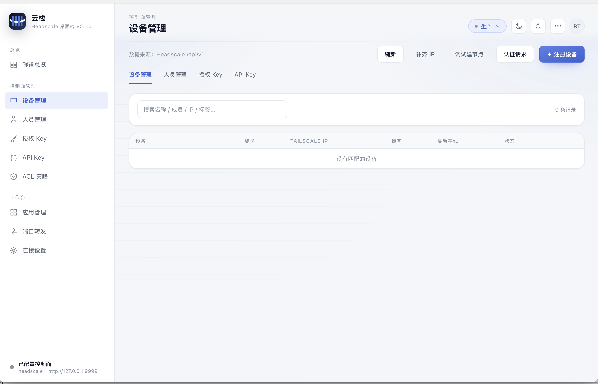
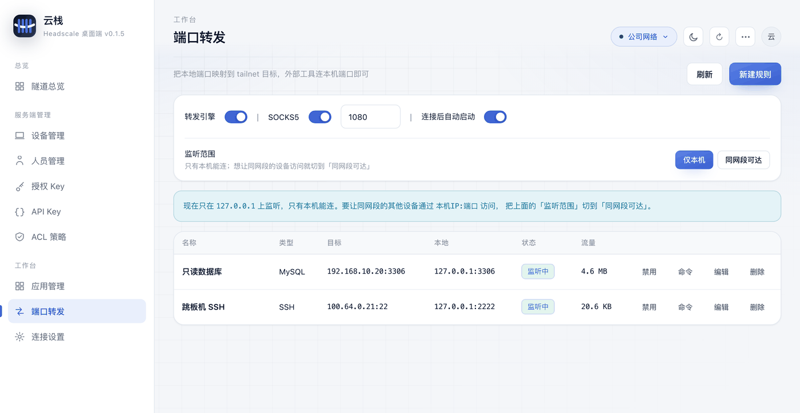

# 云栈 Weft

自建 Headscale 的桌面客户端。节点跑在应用进程里，不需要装 Tailscale 客户端；接管系统网络后，`ssh`、`mysql`、`psql`、`redis-cli` 这些命令行工具直接连 `100.x` 和内网网段，不用配任何代理。

macOS / Windows / Linux，安装即用，没有外部依赖。


## 为什么写这个

自建 Headscale 之后，用官方 Tailscale 客户端总觉得别扭：它把节点注册和自己的账号体系绑在一起，管理功能又得回到 Web 后台。

这个项目把 tsnet 的节点直接嵌进应用进程，界面同时对接 Headscale 的 `/api/v1`。连上之后既能在同一个窗口里看在线设备、审批路由、生成授权 Key，也能直接用系统自带的终端工具访问内网服务。

名字取自《蜀道难》里的「天梯石栈相钩连」。

## 能做什么

| 页面 | 能做的事 |
|---|---|
| 总览 | 连接 / 重连 / 断开、本机地址、在线设备数、已接入网段、运行时长、管理密钥续期、快捷应用、最近事件 |
| 设备管理 | 搜索筛选、注册设备、待审批请求、手动添加节点、补分配 IP、改名、打标签、批准子网路由、到期与删除 |
| 人员管理 | 新建成员（名称 / 显示名 / 邮箱 / 头像）、改名、删除、按成员跳转设备 |
| 授权 Key | 新建（成员、有效期、可复用、临时节点、预设标签）、吊销、删除 |
| API Key | 新建、吊销、删除，查看前缀与最后使用时间 |
| ACL 策略 | 用户组与标签、规则表单、权限矩阵、源码编辑、校验与保存 |
| 应用管理 | 内网 Web 服务书签，应用内窗口或系统浏览器打开，分组与图标 |
| 端口转发 | 本地端口映射、SOCKS5、监听范围、连接命令、流量统计 |
| 连接设置 | 多服务端、系统助手、外观主题、开机自连、断线重连、托盘常驻 |

顶栏常驻服务端切换器、主题切换、刷新和「更多」菜单（帮助手册、检查更新、关于）。关窗口只是收起，程序留在托盘，隧道不断。

### 总览

连接状态卡直接给结论：连上了就显示本机 `100.x` 地址和在线节点数，失败就写原因。下面四张指标是「在线设备 / 已接入网段 / 运行时长 / 管理密钥」，密钥剩余不到 15 天会变黄，点「续期」新建一把写进系统钥匙串，旧 Key 立即失效。

再往下是本节点信息、已接入网段、快捷应用（来自应用管理）和最近事件。

### 设备、人员与密钥



设备页按名字、IP、标签搜索，也能按状态、成员、标签筛选。每行右侧「管理」打开详情：改名、打 `tag:server` 之类的标签、勾选批准该节点通告的子网路由、让节点立即到期或取消到期、删除设备。

人员页是 headscale 的用户命名空间。成员名就是 ACL 里引用的名字，改名会同步到服务端，设备归属跟着走。删成员前要先清空它名下的设备。

授权 Key 和 API Key 是两回事：

- **授权 Key** 让设备加入 tailnet，等价于 `headscale preauthkeys create`。新建时能选归属成员、1 到 365 天有效期、是否可复用、是否临时节点，还能预设 ACL 标签，注册出来的节点自动带上。
- **API Key** 调管理接口用，云栈自己也要靠它读设备、人员和策略。列表只显示前缀和最后使用时间。

两种 Key 的明文都只显示一次，关掉就查不到，生成后先复制。吊销立即生效，删除只清记录。

### ACL 策略


分三个页签：

- **用户组与标签**：定义「谁」和「哪些设备」。组里填 headscale 用户名，标签填能打这个标签的人。
- **规则**：一条规则读作「谁 → 哪些设备 → 哪些端口」。目标按端口分组，端口能从常用服务里选，也能手写 `8000-8100`，一条规则可加多组目标。策略为空时给三个起点模板：只访问自己的设备、管理员全通其他人各管各的、保持全部互通。
- **源码**：直接改整份 HuJSON，保存前可以校验和格式化。切过去之前会先解析，解析不了就不让切。

规则下面钉着权限矩阵：行是人（和标签），列是设备，每格显示实际能通的端口。哪个成员一行全空，就是写漏了，矩阵会自动展开；某列没人访问只提示，多半是故意隔离。

只出 `accept` 规则（端口级，L4），Grants、Tailscale SSH、autoApprovers 这些表单不碰，保存时原样写回。要在界面里保存，服务端得是 `policy.mode: database`；文件模式只能读，页面上会写明两条改法。

### 应用管理


把 `http://10.0.1.x:8080` 这类地址存成卡片。点「应用内打开」会在本地起反向代理，用独立窗口加载，不需要拼地址也不管证书；`↗` 用系统浏览器打开。地址支持 `100.x`、MagicDNS 名称和自定义域名。

应用是自签 HTTPS 时，应用内窗口会被直接拒绝加载（白屏），去连接设置打开「信任自签 HTTPS 证书」即可。反向代理只在云栈运行期间有效。

书签能在自己的几台设备之间同步，不用一台台重加。一台打开「让其他设备同步本机」并生成同步码，另一台在「同步到其他设备」里选设备、填码，往前拉或往回推都行。合并按地址走：两台都有同一个地址时留改得晚的那份，删除不同步。数据只在两台设备之间传，不经过任何服务器。

### 端口转发



把 tailnet 里的服务映射到本地端口：本地 `3306` → `10.0.1.20:3306`，然后 `mysql -h 127.0.0.1 -P 3306` 就能连。也可以开 SOCKS5（默认 `1080`），让不支持直连的工具走代理。

监听范围默认「仅本机」，只绑 `127.0.0.1`；要让同网段设备也能访问，切到「同网段可达」，再用 `本机IP:端口` 连。每行能禁用、编辑、删除，点「命令」给出对应的连接命令，流量列是累计转发量。

### 连接设置


支持多个 Headscale 服务端，切换时各自的节点身份互相独立，不会串。每个服务端可以编辑、重命名、删除。

系统助手的用途是把建虚拟网卡、改路由的权限收进一个常驻进程，装一次之后不再弹管理员密码；不装就每次连接授权一次。下面还有外观主题、开机自动连接、断线自动重连和托盘常驻。

### 顶栏与托盘

顶栏右边：服务端胶囊（点开切换）、主题、刷新、「更多」菜单。macOS 上 `⌘R` 刷新、`⌘W` 收起窗口、`⌘Q` 退出，Windows 走「更多」和托盘菜单。

托盘菜单提供当前状态、连接 / 断开、显示主窗口、帮助手册、设置、关于和退出。

## 安装

从 [Releases](https://github.com/boothua-cloud/Weft-Desk/releases) 下载对应平台的包：

| 平台 | 文件 |
|---|---|
| macOS (Apple Silicon) | `weft-0.1.5-macos-arm64.dmg` |
| Windows x64 | `weft-0.1.5-windows-amd64-setup.exe`（安装版，装到用户目录，安装本身不需要管理员权限）<br>`weft-0.1.5-windows-amd64.zip`（便携版，解压即用，内含 `wintun.dll`） |
| Linux x64 | `weft_0.1.5-1_amd64.deb`（Ubuntu 24.04+）或 `weft-0.1.5-linux-amd64.tar.gz` |

装好之后应用会自己检查更新，有新版在「更多 → 检查更新」里一键下载并重启即可。发布页里另有两份 `*-update.zip`，那是自动更新专用的中间产物，手动安装不需要下载它们。

Windows 版启动时会请求一次 UAC，创建虚拟网卡要求进程本身有管理员权限。在「连接设置」里装一次「系统助手」，之后开机由计划任务以最高权限拉起，日常不再弹窗。

## 快速开始

1. 打开「连接设置」，点服务端的「编辑」，填地址
2. 填 Auth Key；留空的话点连接时会走浏览器授权
3. 填 API Key（管理功能用），保存后会自动重连；连不上的话原因写在总览页状态卡上
4. 回总览页点「连接」

两种 Key 别搞混：

```bash
# 本机加入 tailnet
headscale preauthkeys create --user 1

# 管理设备 / 成员 / 路由
headscale apikeys create
```

更细的操作说明在应用内「更多 → 帮助手册」，每个页面和按钮都写了。

## 排障

- **连不上**：看总览页状态卡上的「上次启动失败」，大多是地址不对或 Auth Key 过期；管理页整块提示没 Key 就换 API Key。
- **管理页不见了**：API Key 无效或过期，服务端 `headscale apikeys create` 换一把。
- **ACL 保存不了**：服务端是 `policy.mode: file`，只能读；改成 `database` 再导一次，或直接改服务器上的文件后 `systemctl reload headscale`。
- **应用内窗口白屏**：HTTPS 自签证书被拒，打开「信任自签 HTTPS 证书」，或改用系统浏览器。
- **要看节点日志**：命令行启动 `weft --diag`，`[system]` 开头的是 tsnet 日志，会打印对端在线状态和 DERP。

## 平台支持

| | macOS | Windows | Linux |
|---|---|---|---|
| 网络接口 | `utunN` | WinTun | `/dev/net/tun` |
| 提权 | `osascript` | UAC | `pkexec` / `sudo` |
| 路由 | `route` | IP Helper API | `ip route` |
| 免密方案 | LaunchDaemon | 计划任务 | systemd unit |

macOS 和 Windows 在真机上验证过完整流程。

Linux 目前只针对 **Ubuntu 24.04 桌面版**：编译时链的是 `webkit2gtk-4.1`，22.04 的仓库里只有 4.0，装 `.deb` 会提示依赖不满足。提权和路由清理还需要更多实机验证。

## 构建

需要 Go 1.24+、Node 20+，以及 [Wails v3](https://v3alpha.wails.io/)。

```bash
go install github.com/wailsapp/wails/v3/cmd/wails3@v3.0.0

# macOS
wails3 build -tags devtools && ./scripts/make-app.sh

# Windows（wintun.dll 要和 exe 放一起）
bash scripts/fetch-wintun.sh amd64
wails3 build -tags devtools

# Linux
bash scripts/build-linux.sh
```

CI 在 `.github/workflows/build.yml`，只在打 tag 或手动触发时跑，日常提交不触发。

Linux 必须带 `gtk3` 标签。Wails 默认走 GTK4 + WebKitGTK 6.0，主流发行版仓库里只有 GTK3 那版。

## 已知限制

- 只支持 Headscale，不兼容 Tailscale 官方 API
- 不做 MagicDNS（统一用 IP）、不做 Exit Node、不做 Taildrop
- 子网路由需要先在服务端批准
- 应用内窗口用的是系统 WebView，装不了浏览器扩展（Bitwarden 之类）；需要扩展时改用「用系统浏览器打开」
- Windows 上提权粒度是整个进程，WinTun 没有「把句柄传给非提权进程」这条路

更多实现细节记在 [docs/notes.md](docs/notes.md)。

## License

[MIT](LICENSE)。产物里打包的第三方组件（`tailscale.com`、Wails、wintun.dll 等）各自的许可声明在 [THIRD_PARTY_NOTICES.md](THIRD_PARTY_NOTICES.md)。
