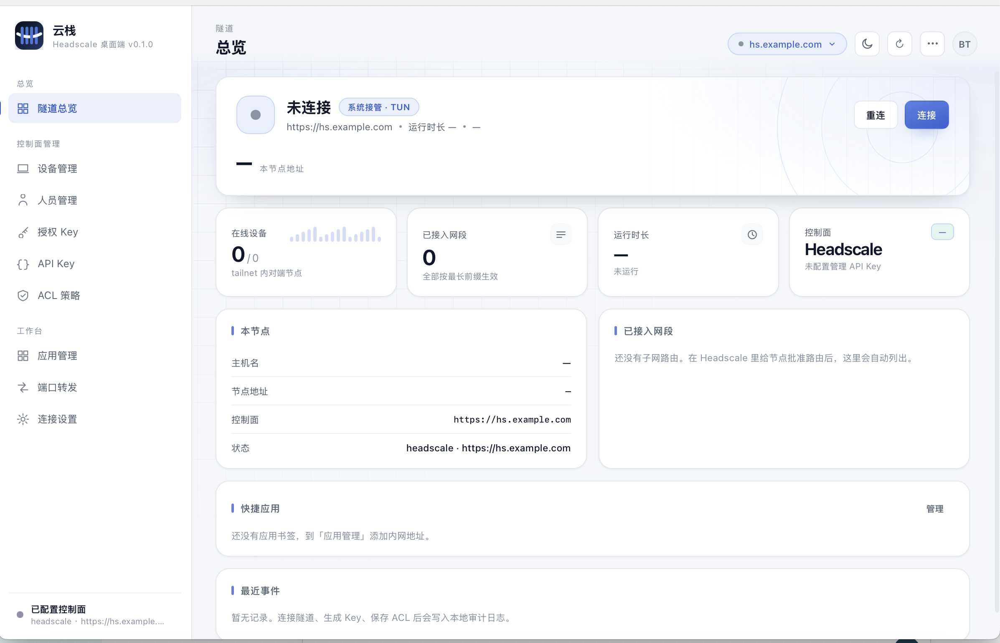

# 云栈 Weft

自建 Headscale 的桌面客户端。节点跑在应用进程里，不需要装 Tailscale 客户端；接管系统网络后，`ssh`、`mysql`、`psql`、`redis-cli` 这些命令行工具直接连 `100.x` 和内网网段，不用配任何代理。

macOS / Windows / Linux，安装即用，没有外部依赖。



## 为什么写这个

自建 Headscale 之后，用官方 Tailscale 客户端总觉得别扭：它把节点注册和自己的账号体系绑在一起，管理功能又得回到 Web 后台。

这个项目把 tsnet 的节点直接嵌进应用进程，界面同时对接 Headscale 的 `/api/v1`。连上之后既能在同一个窗口里看在线设备、审批路由、生成授权 Key，也能直接用系统自带的终端工具访问内网服务。

名字取自《蜀道难》里的「天梯石栈相钩连」。

## 能做什么

- **接入 tailnet**：Auth Key 或浏览器授权，连上后自动接受已批准的子网路由
- **管理系统**：节点、成员、授权 Key、API Key、ACL 策略，直接调 Headscale 接口，报错原样显示
- **内网应用**：把 `http://10.0.1.x:8080` 这类地址存成书签，用应用内窗口或系统浏览器打开
- **端口转发**：本地端口映射和 SOCKS5，默认只监听 `127.0.0.1`
- **系统级网络**：真实 TUN + 系统路由，不是用户态代理

### 设备管理


### ACL 策略


### 连接设置

支持多个 Headscale 服务端，切换时各自的节点身份互相独立，不会串。


## 安装

从 [Releases](https://github.com/boothua-cloud/Weft-Desk/releases) 下载对应平台的包：

| 平台 | 文件 |
|---|---|
| macOS (Apple Silicon) | `weft-0.1.2-macos-arm64.dmg` |
| Windows x64 | `weft-0.1.2-windows-amd64-setup.exe`（安装版，装到用户目录，不需要管理员权限）<br>`weft-0.1.2-windows-amd64.zip`（便携版，解压即用，内含 `wintun.dll`） |
| Linux x64 | `weft_0.1.2_amd64.deb`（Ubuntu 24.04+）或 `weft-0.1.2-linux-amd64.tar.gz` |

Windows 用户第一次点「连接」会弹一次 UAC——这是创建虚拟网卡的硬性要求。装好「系统助手」之后就不再提示。

## 快速开始

1. 打开「连接设置」，填 Headscale 地址和 API Key（管理功能用）
2. 填 Auth Key；留空的话点连接时会走浏览器授权
3. 点「测试连接」，通过后保存
4. 回总览页点「连接」

两种 Key 别搞混：

```bash
# 本机加入 tailnet
headscale preauthkeys create --user 1

# 管理设备 / 成员 / 路由
headscale apikeys create
```

## 平台支持

| | macOS | Windows | Linux |
|---|---|---|---|
| 网络接口 | `utunN` | WinTun | `/dev/net/tun` |
| 提权 | `osascript` | UAC | `pkexec` / `sudo` |
| 路由 | `route` | IP Helper API | `ip route` |
| 免密方案 | LaunchDaemon | 计划任务 | systemd unit |

macOS 和 Windows 在真机上验证过完整流程。

Linux 目前只针对 **Ubuntu 24.04 桌面版**：编译时链的是 `webkit2gtk-4.1`，22.04 的仓库里只有 4.0，装 `.deb` 会提示依赖不满足。提权和路由清理还需要更多实机验证。

## 构建

需要 Go 1.24+、Node 20+，以及 [Wails v3](https://v3alpha.wails.io/)。

```bash
go install github.com/wailsapp/wails/v3/cmd/wails3@v3.0.0

# macOS
wails3 build -tags devtools && ./scripts/make-app.sh

# Windows（wintun.dll 要和 exe 放一起）
bash scripts/fetch-wintun.sh amd64
wails3 build -tags devtools

# Linux
bash scripts/build-linux.sh
```

CI 在 `.github/workflows/build.yml`，只在打 tag 或手动触发时跑，日常提交不触发。

Linux 必须带 `gtk3` 标签——Wails 默认走 GTK4 + WebKitGTK 6.0，主流发行版的仓库里只有 GTK3 那版。

## 已知限制

- 只支持 Headscale，不兼容 Tailscale 官方 API
- 不做 MagicDNS（统一用 IP）、不做 Exit Node、不做 Taildrop
- 子网路由需要先在服务端批准
- 应用内窗口用的是系统 WebView，装不了浏览器扩展（Bitwarden 之类）；需要扩展时改用「用系统浏览器打开」
- Windows 上提权粒度是整个进程——WinTun 没有「把句柄传给非提权进程」这条路径

更多实现细节记在 [docs/notes.md](docs/notes.md)。

## License

[MIT](LICENSE)。产物里打包的第三方组件（`tailscale.com`、Wails、wintun.dll 等）各自的许可声明在 [THIRD_PARTY_NOTICES.md](THIRD_PARTY_NOTICES.md)。
