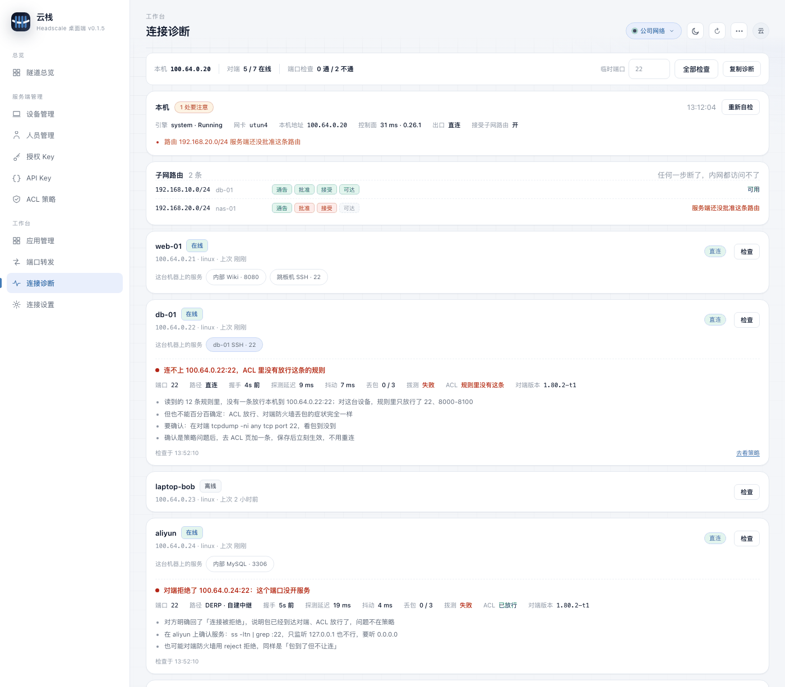

# 云栈 Weft

Headscale 的桌面客户端。tsnet 节点跑在应用进程里，不用另外装 Tailscale 客户端。连接建立后接管系统网络，终端里的 `ssh`、`mysql`、`psql`、`redis-cli` 可以直接连 `100.x` 和子网网段。

macOS、Windows、Linux 都有安装包，装完即可运行。


## 为什么写这个

自建 Headscale 之后，官方 Tailscale 客户端有两处不顺手：节点注册绑在 Tailscale 自己的账号体系上；管设备、成员、ACL 要另外开 Web 后台。

云栈把 tsnet 节点嵌进应用进程，界面直接调 Headscale 的 `/api/v1`。设备和隧道在同一个窗口里。

名字出自《蜀道难》的「天梯石栈相钩连」。

## 功能

| 页面 | 内容 |
|---|---|
| 总览 | 连接与断开、本机地址、在线设备、子网路由、运行时长、管理密钥、对端节点、快捷应用、最近事件 |
| 设备管理 | 搜索筛选、注册设备、待审批请求、添加节点、补 IP、改名、打标签、到期、删除、多选批量 |
| 子网路由 | 所有设备通告的网段，待批准的排前面，逐条或批量批准、撤销，出口节点单独标出 |
| 人员管理 | 新建成员、改名、删除、按成员跳转到设备、多选批量删除 |
| 授权 Key | 新建、吊销、删除、多选批量 |
| API Key | 新建、吊销、删除、多选批量，显示前缀和最后使用时间 |
| ACL 策略 | 用户组与标签、规则表单、权限矩阵、源码编辑、校验保存、策略模板 |
| 应用管理 | 内网 Web 服务书签，应用内窗口或系统浏览器打开 |
| 端口转发 | 本地端口映射、SOCKS5、监听范围、连接命令、流量统计 |
| 连接诊断 | 本机自检、每台设备的链路与目标端口测试、导出诊断包 |
| 操作记录 | 所有写操作的时间、对象、结果，失败看错误原文，可搜可导出 |
| 连接设置 | 多服务端、系统助手、主题、开机自连、断线重连、托盘常驻 |

侧栏只放日常要用的页面，连接诊断、操作记录、连接设置在底部「更多」里。关窗口只是收起，进程留在托盘，隧道不断。

服务端连不上时列表不会变空，用上次拿到的数据顶上，页面顶部出一条灰带写明是哪天的缓存、服务端返回了什么，右边可以重试。这时写操作都不让点，点到只会等到超时。

### 总览

连接卡片直接写结果：连上了显示本机 `100.x` 地址和在线节点数，失败写原因。下面四张指标是在线设备、子网路由、运行时长、管理密钥。密钥剩余不到 15 天会变黄，点「续期」新建一把写进钥匙串，旧的立即失效。

有待处理的事时，卡片下面多一块「需要处理」：路由没批准、7 天内到期、离线超过 7 天、生成很久没用过的授权 Key。每条右边给出对应动作。

再往下是对端节点、生效中的网段、快捷应用和最近事件。

### 设备、人员与密钥


设备页支持按名字、IP、标签搜索，也能按状态、成员、标签筛选。每行右侧「管理」打开详情：改名、打 `tag:server` 这类标签、批准该节点通告的子网路由、让节点立即到期或取消、删除。

要一次处理好几台就在第一列勾上，底部浮出一条：打标签、取消到期、登出、取消选择。表头那格选的是当前筛选结果，不是整张表，筛完再全选是常规用法。打标签是合并，只加不减——服务端的 tags 接口是整份替换，直接写会把已有的冲掉。中间有一台失败不影响其余，做完汇总「完成几台、失败几台」，失败的第一台带原因。批量删除没有：一次误选十几台的代价太大，删除仍走单台。

路由不用逐台进详情批。**子网路由**页把所有设备通告的网段列在一张表里，待批准的排前面，`0.0.0.0/0` 单独标出，行上直接批准或撤销，也可以一次全部批准。已批准的行同样能勾，勾完点「撤销选中」，按设备分组整份提交——服务端接口是整份替换，逐条发会把同一台设备上没勾的一起撤掉。这里改的只是服务端记录，路由器有没有真正转发还要看诊断页。


人员页对应 headscale 的用户命名空间。成员名就是 ACL 里引用的名字，改名会同步到服务端，设备归属跟着走。删成员前要先清空它名下的设备。

人员、授权 Key、API Key 三页也能勾着批量处理：人员只能删，删之前会列出成员名，名下还有设备的删不掉，得先清空；两个 Key 页是吊销和删除。API Key 里当前正在用的那把勾选框是灰的——把它作废等于把管理入口关掉。

授权 Key 和 API Key 不是一回事：

- **授权 Key** 让设备加入 tailnet，等价于 `headscale preauthkeys create`。新建时可以选归属成员、1 到 365 天有效期、是否可复用、是否临时节点，还能预设 ACL 标签，注册出来的节点自动带上。
- **API Key** 给管理接口用，云栈读设备、人员、策略都靠它。列表只显示前缀和最后使用时间。

两种 Key 的明文只在创建时显示一次，关掉就查不到。吊销立即生效，删除只清记录。

### ACL 策略


分三个页签：

- **用户组与标签**：定义「谁」和「哪些设备」。组里填 headscale 用户名，标签填能打这个标签的人。同页还有地址别名，给 IP 起个名字，规则里写 `nas:5000`，设备换地址只改这里；以及自动批准，列表里的身份通告子网路由或出口节点后直接生效。
- **规则**：一条规则读作「谁 → 哪些设备 → 哪些端口」。目标按端口分组，端口可以从常用服务里选，也能在底部一个框里手填：`8080`、`22,80`、`8000-8100` 三种写法混着写都认，回车加入。端口段在卡片里显示成 `8000–8100`，底色跟单个端口分开。一条规则可以加多组目标。策略为空时给三个起点。
- **源码**：直接改整份 HuJSON，保存前可以校验和格式化。切过去之前会先解析，解析不了就不让切。

规则下面是权限矩阵：行是人和标签，列是设备，每格显示实际能通的端口。地址别名标在对应列名下面，指向内网机器的别名单独占一列。

设备和人多的时候，矩阵默认只留规则里提到过的行列，其余折起来，底部写明折了多少，点「显示全部」可以看全。表头和左侧行名吸住，宽表在框内横向滚动。某个成员一行全空会自动展开，一般是规则写漏了；某列没人访问只做提示。

点「保存并应用」不会直接写，先弹一个「线上 → 待保存」的对比：改了哪几行、`+3 / −1` 多少行，确认了才发。基线在弹窗打开时重新拉一次，页面上的原文可能是几分钟前读的，别人期间改过就对不上。有规则的改动会先把原文解析成表单再序列化回来，否则注释和空行会被当成改动标红。对比为空就直接说没有改动，不弹窗。`⌘S` 走同一条路。

校验不过的条目右边常常还有一个按钮，比如把 `admin` 改成 `group:admin`、把 `tag:Server` 改成 `tag:server`。这些是改法唯一的问题，一点就改好；目标写了组、设备不存在这类改法不唯一，只写说明，不给按钮。

要保存，服务端得是 `policy.mode: database`；文件模式只能读，页面上写了两种改法。只处理 `accept` 规则（端口级，L4），Grants、Tailscale SSH 这些段表单不碰，保存时原样写回。

顶栏「模板」可以把当前策略存下来，换服务端也能用。抽屉里分两段：上面是存过的，可以应用、改名、删除；下面是三个起点。应用模板只是填进表单，存不存还是由「保存并应用」决定。同名保存会先问一句再覆盖。

顶栏「历史」保留每次保存前的版本，最近 20 版。可以看某一版跟线上差在哪里，也可以回滚，回滚本身也记一笔。

### 应用管理


把 `http://10.0.1.x:8080` 这类地址存成卡片。点「应用内打开」会在本地起一个反向代理，用独立窗口加载；`↗` 用系统浏览器打开。地址支持 `100.x`、MagicDNS 名称和自定义域名。

应用是自签 HTTPS 时，应用内窗口会白屏。在服务端编辑弹窗里打开「信任内网应用的自签证书」即可。反向代理只在云栈运行期间有效。

窗口右上角那三个点是页面菜单：刷新、后退、复制地址、钉在最前、关闭窗口。钉住之后窗口浮在别的应用上面，一边看内网后台一边点别的东西不会再找不到；再点一次「取消钉住」放回去。

书签可以在自己的几台设备之间同步。一台打开「让其他设备同步本机」生成同步码，另一台在「同步到其他设备」里选设备、填码，拉取或推送都行。按地址合并，同一个地址留改得晚的那份，删除不同步。数据只在两台设备之间传输。

### 端口转发


把 tailnet 里的服务映射到本地端口。比如本地 `3306` 对 `10.0.1.20:3306`，然后 `mysql -h 127.0.0.1 -P 3306` 就能连。也可以开 SOCKS5（默认 `1080`），给不支持直连的工具用。

监听范围默认「仅本机」，只绑 `127.0.0.1`。要让同网段设备访问，切到「同网段可达」，用 `本机IP:端口` 连。每行可以禁用、编辑、删除，点「命令」给出对应的连接命令，流量列是累计转发量。

### 连接诊断



设备管理看谁在线，诊断页看为什么连不上。

打开先跑一次**本机自检**，不看对端：引擎在不在跑、网卡建没建、节点登录没有、服务端能不能连（给毫秒和版本）、出口是直连还是 DERP、子网路由有没有被接管。没连上的时候这块也有内容。引擎自己的告警（UDP 被挡、DERP 不可达、路由冲突）也在这里。

子网路由单独一张卡，每条按「通告 → 批准 → 接受 → 可达」标状态，断在哪一步就写哪一步。没批准的去服务端批；批准了但本机没接受，说明客户端还没拿到。没配管理 Key 时只能看到后两步。

下面是设备。每台一行，右边标明当前路径：直连是点对点打通了，中继是没打通、走 DERP，能通但慢一些。离线设备不显示路径。应用书签和端口转发里登记过的服务会做成标签挂在设备上，点标签就按那个端口测。

点「检查」连发三次探测看链路，再连一次目标端口。结论从链路层往上排：对端离线就到这里，探测全丢是链路问题，剩下的端口不通看拨测返回的错误：

- **连接被拒绝**：包到达了对端，被回了 RST。ACL 是通的，端口上没有服务在听，或者服务只监听了 `127.0.0.1`。
- **超时**：包丢在中间，可能是 ACL，也可能是对端防火墙。两种都列出来，附一条 `tcpdump` 命令。
- **没有到主机的路由**：本机路由表没装上，跟 ACL 无关，去看上面那张子网路由卡。

ACL 一栏只在端口不通时出现，分放行、规则里没有、判不了三种。判不了是因为服务端下发的规则里有 `group:ops` 这类表达式，成员列表在服务端，客户端算不出来。

检查完顶栏会写几台通几台不通。要发给别人就点「复制诊断」。

要贴给别人看又不想挑拣，点「生成诊断包」，打成一个 zip：版本和平台、脱敏后的配置、本机自检结果、完整诊断快照、日志末尾 800 行。管理密钥和授权 Key 整段换成 `<redacted>`，邮箱中间打码，`100.64.x.x` 只留前两段，网址去掉路径和参数，域名保留——诊断要看服务端通不通。自检和诊断各限时 6 秒，服务端停着也能出包，超时的项写「超时」。生成完在访达里选中文件，直接拖进聊天窗口就行。

### 操作记录

改设备、改成员、动 Key、存策略、批量操作，都在这里记一条：时间、动作、对象、结果。失败的行点开看服务端原文，比「操作失败」有用。

筛选是本地做的：关键字匹配动作和对象，再叠结果和时间范围，改条件不发请求。默认给最近 2000 条，更早的按时间裁掉。

「导出 CSV」把当前筛选结果写成文件，带 BOM，Excel 打开中文不乱码。

### 连接设置


可以存多个 Headscale 服务端，各自的节点身份互相独立，切换不会串。每个服务端能编辑、重命名、删除。

服务端用自签证书时，在弹窗里打开「服务端用自签证书」，贴 CA 就只认这一份（caddy 的在 `~/.local/share/caddy/pki/authorities/local/root.crt`，mkcert 的用 `mkcert -CAROOT` 找），留空则跳过校验。系统开着代理也能连，先看环境变量，其次读系统设置，例外列表里的地址不走代理。

系统助手把建虚拟网卡、改路由的权限收进一个常驻进程，装一次之后不再弹管理员密码；不装就每次连接授权一次。下面还有主题、开机自动连接、断线自动重连和托盘常驻。

### 侧栏与托盘

侧栏最上面是搜索框，点一下（或者 `⌘K`）打开命令面板：一个框里搜页面、设备名、应用书签名，也能直接说「刷新」「连接」「诊断包」「切换主题」。上下键选，回车执行。搜到设备会跳到设备页并把名字填进搜索框。Windows 用 `Ctrl+K`。侧栏收起后它缩成一枚放大镜按钮。

导航只放日常用的：总览、服务端管理六页、应用管理、端口转发。连接诊断、操作记录、连接设置不是天天点的，收进底部「更多」，那边还放刷新、生成诊断包、主题、帮助手册、检查和更新。停在这三页的任意一页时，「更多」那颗按钮会亮起来。

侧栏最下面是服务端卡片：状态点、名字、连接状态，点开往上弹切换器，底部有「管理服务端…」。再下面三个按钮是主题、刷新、「更多」。侧栏收起后只剩状态点和「更多」，菜单向右弹出。

macOS 上 `⌘R` 刷新、`⌘W` 收起窗口、`⌘Q` 退出。Windows 走「更多」和托盘菜单。

托盘菜单里有当前状态、连接 / 断开、显示主窗口、帮助手册、设置、关于和退出。

## 安装

从 [Releases](https://github.com/boothua-cloud/Weft-Desk/releases) 下载：

| 平台 | 文件 |
|---|---|
| macOS (Apple Silicon) | `weft-0.1.5-macos-arm64.dmg` |
| Windows x64 | `weft-0.1.5-windows-amd64-setup.exe`（装到用户目录，安装不需要管理员权限）<br>`weft-0.1.5-windows-amd64.zip`（便携版，解压即用，内含 `wintun.dll`） |
| Linux x64 | `weft_0.1.5-1_amd64.deb`（Ubuntu 24.04+）或 `weft-0.1.5-linux-amd64.tar.gz` |

装好之后应用会自己查更新，有新版可以在「更多 → 检查更新」里下载并重启。发布页里两份 `*-update.zip` 是自动更新用的中间产物，手动安装不用管。

Windows 版启动时请求一次 UAC，创建虚拟网卡需要进程本身有管理员权限。在「连接设置」里装一次系统助手，之后开机由计划任务以最高权限拉起，平时不再弹。

## 快速开始

1. 打开「连接设置」，点服务端那一行的「编辑」，填地址
2. 填 Auth Key。留空的话点连接时会走浏览器授权
3. 填 API Key，管理功能用。保存后会自动重连，连不上会在总览页状态卡上写原因
4. 回总览页点「连接」

两个 Key 别搞混：

```bash
# 本机加入 tailnet
headscale preauthkeys create --user 1

# 管理设备 / 成员 / 路由
headscale apikeys create
```

更细的操作在应用内「更多 → 帮助手册」。

## 排障

- **连不上**：看总览页状态卡的「上次启动失败」，多半是地址不对或 Auth Key 过期。管理页整块提示没 Key 就换 API Key。
- **管理页不见了**：API Key 失效或过期，用 `headscale apikeys create` 换一把。
- **ACL 保存不了**：服务端是 `policy.mode: file`，只能读。改成 `database` 再导入一次，或者直接改服务器上的文件后 `systemctl reload headscale`。
- **应用内窗口白屏**：自签 HTTPS 被拒，打开服务端弹窗里的「信任内网应用的自签证书」，或改用系统浏览器。
- **要看节点日志**：命令行启动 `weft --diag`，`[system]` 开头的是 tsnet 日志，会打印对端在线状态和 DERP。

## 平台支持

| | macOS | Windows | Linux |
|---|---|---|---|
| 网络接口 | `utunN` | WinTun | `/dev/net/tun` |
| 提权 | `osascript` | UAC | `pkexec` / `sudo` |
| 路由 | `route` | IP Helper API | `ip route` |
| 免密方案 | LaunchDaemon | 计划任务 | systemd unit |

macOS 和 Windows 在真机上跑过完整流程。

Linux 目前只针对 **Ubuntu 24.04 桌面版**。编译时链的是 `webkit2gtk-4.1`，22.04 的仓库里只有 4.0，装 `.deb` 会提示依赖不满足。提权和路由清理还需要更多实机验证。

装完菜单里图标不对的话，手动重建一次缓存：

```bash
sudo update-desktop-database /usr/share/applications
sudo gtk-update-icon-cache -f -t /usr/share/icons/hicolor
```

## 构建

需要 Go 1.24+、Node 20+，以及 [Wails v3](https://v3alpha.wails.io/)。

```bash
go install github.com/wailsapp/wails/v3/cmd/wails3@v3.0.0

# macOS
wails3 build -tags devtools && ./scripts/make-app.sh

# Windows（wintun.dll 要和 exe 放一起）
bash scripts/fetch-wintun.sh amd64
wails3 build -tags devtools

# Linux
bash scripts/build-linux.sh
```

CI 在 `.github/workflows/build.yml`，只在打 tag 或手动触发时跑。

Linux 必须带 `gtk3` 标签。Wails 默认用 GTK4 + WebKitGTK 6.0，主流发行版仓库里只有 GTK3 那版。

## 代码结构

后端是一个 Go module，界面在 `frontend/`。根目录只放启动装配和必须留在这里的东西：

```
main.go            进程入口：单实例、提权分支、--diag 分流，再交给 desktop.Run
assets.go          embed 前端产物、应用图标、托盘图标
appname_darwin.*   cgo 改菜单栏名字，链接 Foundation / AppKit，只能在根包
```

`//go:embed` 只能引用本包目录下的文件，而 `frontend/dist` 和 `build/` 都在根目录，所以资源留在根包，图标作为变量传给界面层。

桌面壳层在 `internal/desktop`，前端能调到的只有这里的 `WeftService`：

| 文件 | 说明 |
|---|---|
| `run.go` | `desktop.Run`：建 App、菜单、主窗口、快捷键、事件循环 |
| `service.go` | 结构体、构造、启动与重连、退出，绑定层共用的小工具 |
| `config.go` | 配置与连接档案（Profile） |
| `credential.go` | 界面偏好、Auth Key 与管理 Key 的存取、到期续期 |
| `state.go` | 总览页状态、连接与断开 |
| `nodes.go` | 设备、路由审批、节点认证 |
| `admin.go` | 成员、授权 Key、ACL 策略 |
| `apps.go` | 应用书签 |
| `bundle.go` | 导出文本与诊断包（组 zip、落地、在文件管理器里选中） |
| `redact.go` | 脱敏：管理密钥、授权 Key、邮箱、内网地址、网址路径 |
| `forwards.go` | 端口转发与 SOCKS5 |
| `helper.go` | 系统提权助手 |
| `sync.go` / `update.go` / `selfcheck.go` | 书签同步、自动更新、本机自检 |
| `tray.go` | 托盘菜单、关窗收起、状态轮询 |
| `overlay.go` | 应用内窗口的悬浮条与控制端点 |
| `diag.go` | `weft --diag` 的终端诊断，不进 GUI |

Wails 启动时扫 `WeftService` 的公开方法，生成 `frontend/bindings/github.com/boothua/weft/internal/desktop/`。参数和返回值都是 JSON 字符串，界面不碰 Go 的 struct。

其余实现按职责放在 `internal/`：

| 包 | 说明 |
|---|---|
| `model` | 前后端交换的结构体、配置字段、`DialFunc` |
| `appinfo` | 版本号、发布源、数据目录、默认节点名 |
| `store` | SQLite：配置、书签、转发、策略历史与模板、审计、离线缓存 |
| `secret` | 系统钥匙串（Keychain / 凭据管理器 / Secret Service） |
| `controlplane` | Headscale `/api/v1` 客户端、TLS、地址校验、离线缓存 |
| `sysproxy` | 读系统代理设置，三个平台各一份 |
| `engine` | 隧道（TUN + tsnet）、提权助手、本地反向代理、单实例、平台路由 |
| `netio` | 端口转发与 SOCKS5 |
| `appsync` | 应用书签的局域网同步 |
| `update` | 自动更新：检查、下载、校验、替换 |
| `desktop` | 桌面壳层，见上面的文件表 |

依赖是单向的，`model` 在最底下：

```
        main.go（进程入口）
              │
        desktop（窗口与绑定层）
   ┌──────┬───┴────┬────────┬────────┐
 store  controlplane engine appsync update ...
   └──────┴────┬───┴────────┴────────┘
             model
```

`store`、`controlplane`、`engine` 这些包不认识 `WeftService`。需要运行时状态的地方（当前引擎、同步码、本机 `100.x` 地址）通过构造函数注入函数。

平台差异用文件名后缀区分：`foo_darwin.go` / `foo_windows.go` / `foo_linux.go`，公共逻辑放在 `foo.go`。

仓库里不放测试文件。改完跑 `go build ./` 和 `go vet ./`；涉及路由、ACL、转发这类逻辑时临时写个 `_test.go` 验一遍，跑完删除。这样不用为了测试把内部函数导出去。

## 已知限制

- 只支持 Headscale，不兼容 Tailscale 官方 API
- 不做 MagicDNS（统一用 IP）、不做 Exit Node、不做 Taildrop
- 子网路由要在服务端批准
- 应用内窗口用系统 WebView，装不了浏览器扩展（Bitwarden 之类），需要扩展时改用系统浏览器
- Windows 上提权粒度是整个进程，WinTun 没有「把句柄传给非提权进程」这条路

实现细节记在 [docs/notes.md](docs/notes.md)。

## License

[MIT](LICENSE)。产物里的第三方组件（`tailscale.com`、Wails、wintun.dll 等）各自的许可声明在 [THIRD_PARTY_NOTICES.md](THIRD_PARTY_NOTICES.md)。
